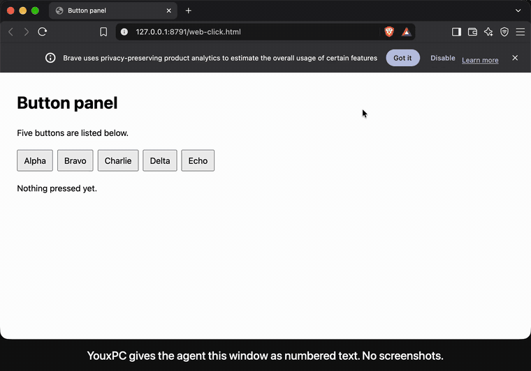
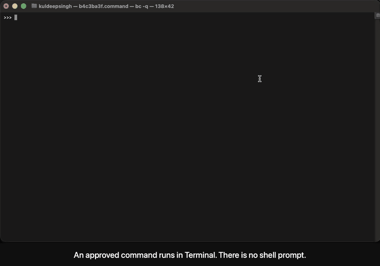

# YouxPC

A local MCP server for macOS that lets any AI agent see and operate desktop apps as numbered text, through the accessibility tree.

**[See it work: recorded runs you can step through, and the benchmark](https://ar5en1c.github.io/youxpc/)**

- **Text, not pixels.** An app's window comes back as one short line per element. No vision model is needed.
- **Act by number.** `pc_click index:"e7"`. The result says what changed on screen, so the agent does not need a second look.
- **Stays out of your way.** Buttons, links and text fields are operated through accessibility. The app can stay in the background and your pointer stays where it is.
- **Safe by default.** Password managers, terminals, System Settings and the app hosting the agent are blocked. Every call is written to a local receipts log.
- **Local.** No telemetry. Works with any MCP client: Claude Code, Codex, Cursor, opencode, or your own loop.

YouxPC is a fork of [Ghost OS](https://github.com/ghostwright/ghost-os) by Ghostwright (MIT). The accessibility engine, recipes and the original tool set are theirs. This fork is not affiliated with or endorsed by them. [What changed](#what-changed-from-ghost-os) is listed below.

## What it looks like



The purple cursor is the agent's. The black one is the real pointer; it does not move. The clip is one unedited take.

A page with five buttons, open in a browser that is in the background:

```
pc_snapshot app:"Brave Browser"
```

```
Brave Browser — "Button panel - Brave"
web "Button panel"
  [e14] button "Alpha"
  [e15] button "Bravo"
  [e16] button "Charlie"
  [e17] button "Delta"
  [e18] button "Echo"
```

```
pc_click index:"e17"
```

```
{"method": "ax-focus-space", "pointer": "virtual", "element": "Delta",
 "changes": "~ [e17] button \"Delta\" (focused)\n+ \"Last pressed: Delta\""}
```

The browser stayed in the background and the pointer did not move. Numbers stay the same across snapshots while an element keeps its role and name. After the first snapshot of a window, later ones return only what was added (`+`), removed (`-`) or changed (`~`).

## Install

Requires macOS 14 or later. The installer downloads the latest release (Apple silicon), checks it against its published checksum and puts `youxpc` in `~/.local/bin`. It is [a short script](install.sh); read it first if you like.

```bash
curl -fsSL https://raw.githubusercontent.com/Ar5en1c/youxpc/main/install.sh | bash
claude mcp add --scope user youxpc -- ~/.local/bin/youxpc mcp
```

Or build it yourself (needs Xcode 26 for Swift 6.2; this is also the way on an Intel Mac):

```bash
git clone https://github.com/Ar5en1c/youxpc.git
cd youxpc
swift build -c release
claude mcp add --scope user youxpc -- "$(pwd)/.build/release/youxpc" mcp
```

The release binary is not notarized by Apple. Installed with the script above or built from source it runs normally; a copy downloaded through a browser would be blocked by Gatekeeper.

For other clients, register the same command (`/path/to/youxpc mcp`) as a stdio MCP server.

macOS asks for two permissions: **Accessibility** and **Screen Recording**. They are granted to the app that launches the server (your terminal, editor or agent app), not to the `youxpc` binary. `youxpc status` shows whether both are in place.

## Tools

Three profiles, chosen with `YOUXPC_TOOLS`:

| Profile | Tools | Fixed context | For |
|---|---|---|---|
| `simple` | 6: `pc_look`, `pc_click`, `pc_type`, `pc_key`, `pc_scroll`, `pc_do` | about 1,000 tokens | Lowest token use; an experiment for small models |
| default | 16 core tools | about 3,200 tokens | Most agents |
| `full` | Everything, plus the long guide | about 9,000 tokens | Recipes, vision, learning mode |

Core tools: `pc_snapshot`, `pc_click`, `pc_type`, `pc_do`, `pc_press`, `pc_hotkey`, `pc_scroll`, `pc_drag`, `pc_hover`, `pc_read`, `pc_screenshot`, `pc_state`, `pc_focus`, `pc_wait`, `pc_recipes`, `pc_run`. `pc_terminal` appears when you approve terminal commands.

In the simple profile every action answers with one line of outcome followed by the screen as it is now, the app is remembered after the first `pc_look`, and a browser's page is listed without its toolbar. The model never has to decide to look again or apply a diff.

### Several actions in one call

A model turn takes seconds; an accessibility press takes a fraction of one. In the benchmark about nine tenths of a run was the model deciding, one call at a time. `pc_do` lets one decision carry several actions:

```
pc_do steps:[{"click":"4"},{"click":"7"},{"click":"Multiply"},{"click":"1"},{"click":"9"},{"click":"Equals"}]
```

```
1. click 4: ok
2. click 7: ok
3. click Multiply: ok
4. click 1: ok
5. click 9: ok
6. click Equals: ok
Changes:
+ "47 × 19"
+ "893"
- "0"
```

- A step is `click`, `type` (with `into`), `key`, `scroll` or `wait`. Steps run in order and stop at the first failure; the answer says which step failed and that the rest were not run.
- A target is an id when written with its `e` (`e7`). Anything else is a name, looked up on the screen as it is at that step, so a step can name something an earlier step made appear. The step waits up to 1.5 s for that name to show up.
- Every step goes through the same checks as a single call: app policy, never-press list, one receipt each.

### What an id means

An id belongs to one element for the whole session. If six rows each have an "Approve" button and the first row goes away, the other five keep their ids. An id whose element is gone is retired, not handed to a neighbour: using it fails with a message, it does not press something else.

A table is listed one row at a time, each row headed by its first text:

```
table
  row "Marlow Quist"
    "Platform"
    [e16] button "Approve"
    [e17] button "Reject"
```

A click or type by a name that several controls share is refused, with each candidate's id and row, instead of acting on the first one.

## How actions are delivered

Every result has a `pointer` field saying which path was used.

| Target | Delivery | Your pointer | App in front? |
|---|---|---|---|
| Native buttons, menus, checkboxes, tabs | Accessibility press | Untouched | No |
| Buttons and links inside a web page | Accessibility focus, then Space or Return posted to the browser's process | Untouched | No |
| Text fields | Value set through accessibility, or keys posted to the app's process | Untouched | No |
| Plain keys, Shift and Ctrl chords | Posted to the app's process | Untouched | Best effort |
| Cmd and Option shortcuts | Through the frontmost app, after focus is confirmed | Untouched | Yes |
| Canvas, games, custom-drawn UI, right and double clicks | Real mouse events | Jumps, then returns | Yes |

Keystrokes are always addressed to a specific process. They cannot land in whatever app happens to be in front.

An overlay cursor shows where the agent is acting and fades after a few idle seconds. `YOUXPC_CURSOR=off` hides it.

## Safety

- **App policy.** Keyed on bundle IDs. Blocked by default: the app hosting the agent, system permission prompts, System Settings, the login window, password managers, Keychain Access and terminal emulators. A blocked call fails with the reason.
- **Receipts.** Every tool call is written to `~/.youxpc/logs/receipts.jsonl`: the tool, the target, the outcome, the delivery path, the duration and how much the screen changed. Typed text is not kept unless you ask for it. `youxpc receipts` prints the log.
- **Never-press list.** `YOUXPC_NEVER_PRESS=Send,Delete,Pay` refuses clicks on controls whose name contains one of those words, and Return or Space while such a control has focus. The agent is told to stop and ask you. It prevents the common accident; it is not a boundary (a form can still be submitted with Return from a text field, and unnamed controls cannot be matched).
- **Opt-in for the risky parts.** Learning mode (records your keyboard and mouse), Chrome's debug port and terminal access are all off until you enable them.
- **Untrusted content.** The server instructions tell agents that text read from the screen is data, not instructions.
- **No telemetry.** The only network use is loopback, for an optional local vision model and for Chrome's debug port if enabled.

```
$ youxpc receipts
04:59:58 aa9855ae  ok   pc_snapshot    Google Chrome  (111ms)
05:00:00 aa9855ae  ok   pc_click       [9]  -> YouxAI Apply Agent / Has access to this site  pointer:virtual  +28 -1 ~0  (1588ms)
05:00:00 aa9855ae  FAIL pc_snapshot    Terminal  error: 'Terminal' (com.apple.Terminal) is blocked by the YouxPC app policy because it is a terminal.  (21ms)
05:00:02 aa9855ae  ok   pc_terminal    run  `bc -q`  (1918ms)
```

## Terminal sessions



Terminals are blocked by the app policy. `pc_terminal` is the one way in, and it exists only when you list approved commands:

```
YOUXPC_TERMINAL_COMMANDS=opencode,npm test,git status
```

- A command must start with an approved entry; extra arguments are allowed. It is launched directly, never through a shell, so `;`, `|` and `$()` are plain text.
- There is no shell prompt. The session starts on a cleared screen and ends when the program exits.
- Keystrokes go to the Terminal process only, and only while the approved program is the foreground job in its own window. Terminal can stay in the background.
- Terminal's own shortcuts (paste, new tab, anything with Cmd) cannot be sent.
- Sessions survive a server restart. Windows close themselves when the program exits or the session is closed; the last output stays readable for ten minutes.
- Several sessions can run at once. One agent can drive several CLI agents side by side.
- Apple's Terminal.app only.

An approved program can still do whatever it is able to do. Approving an agent CLI means the driving agent can ask it for anything that CLI permits. `YOUXPC_TERMINAL_SANDBOX=on` runs each command under a macOS sandbox profile that denies file writes outside the working directory and temp directories.

## Settings

Set these in the `env` of the MCP server entry.

| Variable | Effect |
|---|---|
| `YOUXPC_TOOLS` | `simple`, unset (core) or `full` |
| `YOUXPC_ALLOW_APPS` | Comma-separated bundle IDs. When set, only these apps may be used |
| `YOUXPC_DENY_APPS` | Bundle IDs added to the default block list |
| `YOUXPC_APP_POLICY=off` | Disable app checks |
| `YOUXPC_NEVER_PRESS` | Comma-separated words. Controls named with one of them are never pressed |
| `YOUXPC_RECEIPTS` | `standard` (default), `full` (also keeps typed text) or `off` |
| `YOUXPC_TERMINAL_COMMANDS` | Approved commands; enables `pc_terminal` |
| `YOUXPC_TERMINAL_SANDBOX=on` | Write-jail for terminal commands |
| `YOUXPC_TERMINAL_SANDBOX_WRITE` | Extra writable paths for the sandbox |
| `YOUXPC_TERMINAL_SANDBOX_NETWORK=off` | Deny network to sandboxed commands |
| `YOUXPC_TERMINAL_IDLE_HOURS` | Stop and close sessions unused this long (default 12) |
| `YOUXPC_INLINE_CHANGES=off` | Do not attach screen changes to action results |
| `YOUXPC_KEYBOARD=global` | Send keys to the frontmost app instead of a specific process |
| `YOUXPC_CURSOR=off` | Hide the overlay cursor |
| `YOUXPC_POINTER_RETURN=off` | Leave the pointer where a real click happened |
| `YOUXPC_LEARNING=on` | Enable learning mode |
| `YOUXPC_CDP=on` | Allow use of Chrome's debug port |
| `YOUXPC_VISION_URL`, `YOUXPC_VISION_PORT` | Optional local vision sidecar, loopback only |

## Benchmarks

<!-- BENCH:START -->
Seventeen desktop tasks on one M1 Mac: ten short ones (Calculator, TextEdit, web pages in Brave) and seven harder ones (rows of identical buttons, a seven-field form, a confirm dialog, tabs, late-arriving content). The same model drove each tool stack, so only the tools differ. Three trials per task with Claude Haiku 5.5:

| Tool stack | Runs passed | Total time | Tool calls | Tokens |
|---|---|---|---|---|
| YouxPC, default profile | 51 of 51 | 629 s | 216 | 2,110,340 |
| YouxPC, simple profile | 51 of 51 | 638 s | 189 | 1,413,032 |
| Ghost OS 2.2.1 (upstream) | 46 of 51 | 1,176 s | 699 | 9,007,227 |

- **Time and cost:** against upstream, the default profile took 47% less time, made 69% fewer tool calls and read 77% fewer tokens. Most of that is `pc_do`: one model decision carries several actions.
- **Reliability:** YouxPC passed every run. Ghost OS failed five, all on three of the harder tasks: it pressed the wrong one of six identical buttons, opened a near-duplicate search result first, and once could not confirm a deletion. On the ten short tasks all three passed 30 of 30.
- **Bias to know about:** I wrote the seven harder tasks and fixed YouxPC against them by hand before any model run; Ghost OS had no such preparation. What the result supports is "more reliable on tasks with repeated control names and confirm dialogs", not "more reliable in general". Tasks written by someone else are the missing test.

Against other free tools, same model and tasks, three trials each, all at default settings:

| Tool | Runs passed | Total time | Tool calls | Tokens |
|---|---|---|---|---|
| YouxPC, default profile | 50 of 51 | 630 s | 216 | 2,050,398 |
| Cua Driver 0.35.2 | 51 of 51 | 1,287 s | 441 | 23,902,869 |
| Peekaboo 4.9.2, `--allow-foreground` | 41 of 51 | 1,897 s | 819 | 43,644,540 |
| Playwright MCP 0.0.83, web tasks only | 39 of 39 | 448 s | 243 | 2,309,907 |
| YouxPC on those web tasks | 38 of 39 | 465 s | 184 | 1,674,039 |

- **Cua Driver** was as reliable (it passed every run); YouxPC took 51% less time and read 91% fewer tokens.
- **Playwright MCP** and YouxPC are about level on web pages. Playwright drives its own headless browser and cannot reach desktop apps or a real browser's toolbar.
- **Peekaboo** passed every desktop-app run and struggled with buttons inside web pages; its server is background-only unless started with that flag.
- YouxPC's one failure was the model clicking Approve where Reject was asked for.
- The other tools ran as installed, untuned; YouxPC has been worked over on these tasks.

- With a second model (`gpt-6-luna` through the Codex CLI, one trial, an earlier build): YouxPC 14 of 17 in 348 s and 49 tool calls, Ghost OS 13 of 17 in 929 s and 178.
- Not measured: Codex's own computer use (it needs per-app approval and the runs were unattended). Small local models were tried and none was reliable; the best passed 4 of 10.

Method, per-task results, every failure explained and how to reproduce: [bench/RESULTS.md](bench/RESULTS.md).
<!-- BENCH:END -->

## What changed from Ghost OS

- `pc_snapshot`: a numbered, compact tree with stable numbers and a changes-only mode, read with one batched accessibility call per element.
- Actions by number, and action results that report what changed once the screen has settled.
- `pc_do`: several actions in one call, with waiting for named targets and for menus built in.
- Ids that stay with their element for the session, table rows listed as rows, and refusal when a name is shared by several controls.
- Pointer-free delivery for native controls, web controls and typing, with every keystroke addressed to a process.
- An overlay cursor.
- App policy, receipts log, and opt-in for learning mode and Chrome's debug port.
- Approved-command terminal sessions with persistence, cleanup and an optional sandbox.
- Three tool profiles, including a six-tool one that uses the fewest tokens.
- Recipe names are validated.
- Screenshots default to a width-capped JPEG.

## Limits

- macOS only. Terminal sessions work with Apple Terminal only.
- Targets with no accessible control (canvas, games, custom-drawn UI) still need the real pointer for a moment, and the app in front.
- Cmd and Option shortcuts need the app in front.
- Sending mouse events directly to a background app's process did not work in Chrome, which is why clicks go through accessibility instead.
- VS Code's accessibility tree stayed nearly empty in testing.
- There is no confirmation step before sending, deleting or paying. The never-press list is the only guard, and you have to set it.
- An app that stops answering accessibility calls can hold a tool call for several seconds; a snapshot gives up after about four seconds plus one call.
- Chrome's tab strip is only partly visible to the accessibility API.
- Content scrolled out of view is not listed until you scroll to it.
- Tested on Chrome, Brave, TextEdit, Terminal and VS Code. Not yet tested broadly across native apps.

## Licence and credits

MIT. Upstream copyright is retained. Built on [Ghost OS](https://github.com/ghostwright/ghost-os) by Ghostwright and [AXorcist](https://github.com/steipete/AXorcist) by Peter Steinberger. Maintained by Kuldeep Singh.
